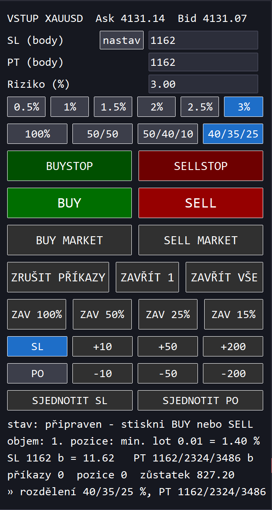

# Puntiky Quick Entry — rychlý vstup do pozice pro MetaTrader 5

Expert Advisor pro MT5 (RoboForex, XAUUSD), který zadá obchod na **dvě
kliknutí**: tlačítko `BUY` / `SELL` (nebo `BUYSTOP` / `SELLSTOP`) v panelu
a klik do grafu na místo vstupu. Podle polohy kliknutí vůči aktuální ceně
vznikne **STOP příkaz**, **LIMIT příkaz**, nebo **MARKET příkaz** (tlačítka
`BUYSTOP` / `SELLSTOP` LIMIT nezadávají), vždy rovnou se **stop lossem
a profit targetem** a s objemem dopočítaným z **rizika v procentech zůstatku
účtu** (výchozí 1 %). Tlačítka `BUY MARKET` / `SELL MARKET` vstoupí za trh
**hned jedním kliknutím**, bez výběru místa v grafu. Řada tlačítek `ZAV …`
zavře zadané procento otevřené pozice, dvě řady pod ní **posunou SL nebo
celé čekající příkazy** nahoru či dolů a poslední řada je **sjednotí na
průměrnou úroveň**. Obchoduje se vždy symbol grafu, na
kterém expert běží.

Expert sám nikdy nic neobchoduje — dělá jen to, co se mu klikne.

## Jak se používá

1. Přetáhni experta `PuntikyQuickEntry` na graf **XAUUSD** (nebo jiného
   symbolu — expert obchoduje vždy symbol grafu, na kterém běží; symbol je
   vidět v titulku panelu).
2. V panelu vlevo nahoře je formulář předvyplněný z nastavení experta:
   `SL (body)`, `PT (body)`, `Riziko (%)`. Kteroukoli hodnotu lze
   před obchodem přepsat (Enter nebo odchod z pole ji potvrdí; nesmysl se vrátí
   na poslední platnou hodnotu a důvod se ukáže v panelu).
   SL a PT lze i **změřit v grafu** tlačítkem `nastav` mezi popiskem a polem
   `SL (body)`: první klik do grafu určí výchozí bod (plná linka), za myší pak
   jede tečkovaná linka s popiskem vzdálenosti v bodech a druhý klik ji zapíše
   do `SL` i `PT` (PT = SL). Během měření je na tlačítku `zrušit`; měření ruší
   i **Esc** a stisk tlačítka vstupu (výběr vstupu a měření neběží zároveň).
   Pod polem `Riziko (%)` je řada tlačítek s předvolbami (`0.5%  1%  1.5%  2%
   2.5%  3%`, nastavitelné vstupem `InpRiskPresets`) — klik nastaví riziko a zapíše
   ho do pole, zvýrazněné je tlačítko odpovídající aktuální hodnotě (po startu
   tedy `InpRiskPercent`, výchozí 1 %). Ručně zapsaná hodnota mimo předvolby
   nezvýrazní žádné.
   Pod ní je řada `100%  50/50  50/40/10  40/35/25` — **na kolik pozic a v jakém
   poměru se riziko rozdělí** (viz
   [Více pozic jedním vstupem](#více-pozic-jedním-vstupem)); po startu je
   vybraná `100%`.
3. Stiskni `BUY` nebo `SELL` (případně `BUYSTOP` nebo `SELLSTOP` v řadě nad
   nimi, viz níže). Tlačítko se změní na `ZRUŠIT BUY` / `ZRUŠIT SELL`
   (`ZRUŠIT BUYSTOP` / `ZRUŠIT SELLSTOP`) a za myší začne jezdit **linka
   vstupu** spolu s linkami SL a PT a popiskem, který říká přesně, co klik
   udělá — včetně objemu.
4. Klikni do grafu na místo vstupu:

   | Tlačítko | Klik | Výsledek |
   |---|---|---|
   | BUY  | nad Ask (dál než stop-level brokera) | `BUY STOP` na kliknuté ceně |
   | BUY  | pod Ask (dál než stop-level brokera) | `BUY LIMIT` na kliknuté ceně |
   | BUY  | na Ask nebo těsně pod ním (do stop-levelu) | `BUY` za trh (aktuální Ask) |
   | SELL | pod Bid (dál než stop-level brokera) | `SELL STOP` na kliknuté ceně |
   | SELL | nad Bid (dál než stop-level brokera) | `SELL LIMIT` na kliknuté ceně |
   | SELL | na Bid nebo těsně nad ním (do stop-levelu) | `SELL` za trh (aktuální Bid) |
   | BUYSTOP  | nad Ask (dál než stop-level brokera) | `BUY STOP` na kliknuté ceně |
   | BUYSTOP  | na Ask nebo pod ním | `BUY` za trh (aktuální Ask) |
   | SELLSTOP | pod Bid (dál než stop-level brokera) | `SELL STOP` na kliknuté ceně |
   | SELLSTOP | na Bid nebo nad ním | `SELL` za trh (aktuální Bid) |

   Tlačítka `BUYSTOP` / `SELLSTOP` tedy LIMIT příkazy nezadávají: na „druhé“
   straně trhu (BUY pod Ask, SELL nad Bid) vždy vstoupí za trh. U `BUY` /
   `SELL` vznikne vstup za trh jen kliknutím těsně u ceny, kde by broker LIMIT
   nepřijal (při stop-levelu 0 prakticky jen přesně na Ask / Bid).

   Linka STOP příkazu je **čárkovaná**, linka LIMIT příkazu **čerchovaná**
   a linka MARKET vstupu **plná** (drží se aktuální ceny). Kliknutí v pásmu
   mezi trhem a stop-levelem brokera na straně STOP příkazu se odmítne (šedá
   linka, důvod v popisku) a výběr zůstává aktivní.
5. Po odeslání příkazu výběr končí a panel na řádku `poslední:` ukáže ticket,
   cenu a objem; detaily včetně SL a PT jsou v Expert logu.

Výběr se ruší klávesou **Esc** nebo opětovným stiskem téhož tlačítka. Stisk
jiného tlačítka vstupu během výběru jen přepne směr nebo variantu.

### Více pozic jedním vstupem

Řada tlačítek rozdělení rizika pod předvolbami rizika určí, kolik pozic otevře
každý vstup (`BUY` / `SELL`, `BUYSTOP` / `SELLSTOP` i `BUY MARKET` /
`SELL MARKET`) a jaký podíl rizika každá dostane:

| Tlačítko | Pozice | Podíl rizika pro PT, 2×PT, 3×PT |
|---|---|---|
| `100%` | jedna | 100 % (PT) |
| `50/50` | dvě | 50 % (PT), 50 % (2×PT) |
| `50/40/10` | tři | 50 % (PT), 40 % (2×PT), 10 % (3×PT) |
| `40/35/25` | tři | 40 % (PT), 35 % (2×PT), 25 % (3×PT) |

- **Nejbližší PT dostane první podíl**, nejvzdálenější poslední.
- **SL je všem pozicím stejný** (z pole `SL (body)`), PT se násobí pořadím
  pozice; při `PT = 0` jsou všechny pozice bez PT.
- **Riziko z pole `Riziko (%)` se dělí podle poměru** — celková ztráta při
  zásahu SL tak odpovídá zadanému procentu. Např. riziko 2 % a `50/40/10` =
  pozice s rizikem 1 %, 0,8 % a 0,2 %. Objem každé pozice se zaokrouhlí dolů
  na krok objemu zvlášť; když na některou nestačí minimální lot (typicky ta
  s 10 %), tlačítka vstupu zešednou a panel řekne, která pozice to je. Marže se ověřuje
  za všechny pozice dohromady.
- Každá pozice je samostatný příkaz (komentář `PQE BUYSTOP 2/3` apod.); když
  server některý odmítne, další se už neposílají a panel ukáže, kolik jich
  prošlo.
- Náhled v grafu kreslí linku PT pro každou pozici; popisek a řádek `objem`
  ukazují objemy pozic jako `0.05/0.04/0.01`.
- Funguje jen na **hedging** účtu — netting by pozice sloučil do jedné
  s jediným PT, proto tam jsou rozdělení na víc pozic šedá.

Po spuštění experta (i po změně parametrů nebo rekompilaci) je vybrané `100%`.
Poměry jsou v kódu (tabulka `g_splitShares`).

### Vstup za trh jedním kliknutím

Tlačítka `BUY MARKET` / `SELL MARKET` (třetí řada vstupů, pod `BUY` / `SELL`)
otevřou obchod **hned** za aktuální Ask / Bid — do grafu se neklikává
a nic se nepotvrzuje. SL, PT a objem z rizika se berou z formuláře stejně
jako u ostatních vstupů (včetně kontroly stop-levelu a volné marže)
a po vyplnění se SL/PT dorovnají na skutečnou plnicí cenu. Bublina tlačítka
ukazuje, s jakým objemem obchod otevře. Probíhající výběr místa vstupu
stisk zruší.

### Zavírání

Pod tlačítky vstupu je řada tří tlačítek zavírání (vždy jen obchody s magic number
experta, cizí pozice a příkazy nechává; bez potvrzování):

| Tlačítko | Co udělá |
|---|---|
| `ZRUŠIT PŘÍKAZY` | zruší **všechny** čekající příkazy experta (STOP i LIMIT), otevřené pozice nechá |
| `ZAVŘÍT 1` | zavře **jednu** pozici experta za trh — při více pozicích (hedging) tu **nejstarší** (FIFO) |
| `ZAVŘÍT VŠE` | zavře všechny pozice experta a zruší všechny jeho čekající příkazy |

Tlačítko, pro které na trhu nic není, je šedé a důvod má v bublině; počty jsou
na stavovém řádku `příkazy … pozice …`. Výsledek se zapíše na řádek `»` i do
Expert logu.

Poslední řada `ZAV 100%`, `ZAV 50%`, `ZAV 25%`, `ZAV 15%` (nastavitelné
vstupem `InpClosePresets`, nejvýše 4 tlačítka) zavře za trh část pozic:

- zavírá z **každé** otevřené pozice experta — z každé její adekvátní díl;
  bez pozice je řada šedá a důvod je v bublině,
- procento se počítá vždy z **původního (celkového) objemu** pozice, ne ze
  zbytku po předchozím zavírání: z pozice 1.00 lot zavře `ZAV 25%` pokaždé
  0.25 lot, takže čtyři stisky zavřou celou pozici,
- **vždy něco zavře**: díl se zaokrouhlí na nejbližší krok objemu symbolu,
  ale nejméně na minimální lot (u forexu a XAUUSD 0.01) — `ZAV 15%`
  z pozice 0.05 lot tak zavře 0.01 lot,
- je-li zbytek pozice menší než díl (nebo jde o `ZAV 100%`), nebo by po
  zavření zbyl objem pod minimálním lotem, zavře se celá pozice,
- čekající příkazy nechává; bublina tlačítka ukazuje, kolik lotů ze všech
  pozic dohromady zavře, Expert log má řádek pro každou pozici.

Na netting účtu, kde MT5 částečné zavření pozice nezná, se pozice zmenší
obchodem opačným směrem (bez SL a PT, úrovně pozice zůstanou).

### Posun SL a čekajících příkazů

Pod řadou `ZAV …` jsou dvě řady tlačítek:

```
[ SL ] [ +10 ] [ +50 ] [ +200 ]   ← posun nahoru
[ PO ] [ -10 ] [ -50 ] [ -200 ]   ← posun dolů
```

První tlačítka řad jsou **přepínač režimu** (zvolený je modrý, po startu `SL`):

| Režim | Co posun udělá |
|---|---|
| `SL` | posune **SL všech pozic i čekajících příkazů** experta; vstup, PT a objem zůstávají (riziko se tedy mění) |
| `PO` | posune **celé čekající příkazy** (pending orders) experta i s jejich SL a PT — vzdálenosti, objem i riziko zůstávají |

Zbytek první řady posouvá **nahoru**, zbytek druhé **dolů** o malý krok na
doladění, střední a velký krok — výchozí 10 / 50 / 200 bodů (u XAUUSD
0,10 / 0,50 / 2,00), nastavitelné vstupy `InpMoveMinPoints`,
`InpMoveMidPoints`, `InpMoveMaxPoints`.

- Hýbe se vždy se **všemi** pozicemi / příkazy experta naráz (typicky 1–3
  z jednoho vstupu); obchody bez SL režim `SL` přeskočí.
- SL musí zůstat na ztrátové straně dál než stop-level brokera (u pozice od
  aktuální ceny, u příkazu od jeho vstupu). Příkaz se posunem nepřevede na
  jiný typ — kdyby se BUY STOP dostal pod Ask apod., zůstane na místě. Co se
  posunout nedá, se počítá jako `selhalo` a důvod je v Expert logu.
- Po posunu SL čekajícího příkazu se po vyplnění dorovná už nová vzdálenost SL.
- Bez potvrzování; tlačítka, která v daném režimu nemají co posunout, jsou
  šedá s důvodem v bublině.

### Sjednocení SL a čekajících příkazů

Pod řadami posunu jsou tlačítka `SJEDNOTIT SL` a `SJEDNOTIT PO`. Když SL
(nebo ceny čekajících příkazů) neleží na stejné úrovni, srovnají je na
jednu — **prostý průměr** jejich úrovní:

| Tlačítko | Co udělá |
|---|---|
| `SJEDNOTIT SL` | SL všech pozic i čekajících příkazů experta na průměrný SL — **zvlášť nákupy (BUY) a zvlášť prodeje (SELL)**; vstup, PT a objem zůstávají |
| `SJEDNOTIT PO` | čekající příkazy na průměrnou cenu — **zvlášť každý typ** (BUY STOP, BUY LIMIT, SELL STOP, SELL LIMIT); SL a PT se posunou s příkazem o stejný kus |

- Co už na průměru je, se nemění; obchody bez SL `SJEDNOTIT SL` přeskočí.
- Platí stejné kontroly jako u posunu (SL dál než stop-level, příkaz na
  správné straně trhu); co nejde, se počítá jako `selhalo` s důvodem v logu.
- Tlačítko je šedé, dokud nejsou aspoň dva obchody (pro `PO` dva čekající
  příkazy).

SL a PT se měří **od vstupní ceny** v bodech (`_Point` symbolu — u XAUUSD se
dvěma desetinnými místy je 300 bodů = 3,00 USD). Panel na řádku `SL … PT …`
vždy ukazuje přepočet na cenu.

## Objem z rizika

Objem se počítá tak, aby ztráta při zásahu SL odpovídala zadanému procentu
**zůstatku** účtu:

```
lot = zůstatek × riziko / 100 / (vzdálenost SL / tick size × tick value ztrátové strany)
```

Výsledek se zaokrouhlí **dolů** na krok objemu symbolu. Když na zadané riziko
nestačí ani nejmenší povolený lot, obchod se nezadá (riziko nesmí tiše přetéct
přes limit) a panel řekne, kolik procent by minimální lot znamenal. Před
odesláním se ještě ověří volná marže.

Řádek `objem:` v panelu ukazuje aktuální výsledek pro hodnoty ve formuláři,
takže je vidět ještě před stiskem tlačítka.

### Dorovnání SL/PT po vyplnění

STOP příkaz na účtu s Market execution se plní za trh, LIMIT příkaz se může
vyplnit i za lepší cenu a MARKET příkaz může mít skluz — SL a PT nastavené od
požadované ceny by pak neseděly s rizikem. Expert
proto po vyplnění (`OnTradeTransaction`) posune SL a PT tak, aby měly od
**skutečné plnicí ceny** stejnou vzdálenost, jakou měly od ceny příkazu. Vypíná
se vstupem `InpAlignStopsToFill`.

## Nastavení experta

| Vstup | Výchozí | Význam |
|---|---|---|
| `InpStopLossPoints` | `300` | Stop loss v bodech — předvyplní se do formuláře |
| `InpTakeProfitPoints` | `300` | Profit target v bodech (0 = bez PT) — předvyplní se do formuláře |
| `InpRiskPercent` | `1.0` | Riziko na obchod v % zůstatku — předvyplní se do formuláře a zvýrazní odpovídající tlačítko |
| `InpRiskPresets` | `0.5;1;1.5;2;2.5;3` | Předvolby rizika pro tlačítka (%, oddělené `;`, nejvýše 8) |
| `InpClosePresets` | `100;50;25;15` | Tlačítka částečného zavření pozic (% původního objemu každé pozice, oddělené `;`, nejvýše 4) |
| `InpSlippage` | `20` | Maximální skluz MARKET příkazu (body) |
| `InpExpirationMinutes` | `0` | Platnost čekajícího příkazu (STOP i LIMIT) v minutách (0 = do zrušení) |
| `InpAlignStopsToFill` | `true` | Po vyplnění dorovnat SL/PT na skutečnou plnicí cenu |
| `InpMagic` | `202608281524` | Magic number příkazů experta |
| `InpMoveMinPoints`, `InpMoveMidPoints`, `InpMoveMaxPoints` | `10`, `50`, `200` | Kroky tlačítek posunu SL / čekajících příkazů (body) |
| `InpPanelX`, `InpPanelY` | `12`, `22` | Poloha panelu v pixelech při 96 DPI (škáluje se s DPI monitoru) |
| `InpPanelOneClickShift` | `60` | Posun panelu dolů, když je zapnuté okno One Click Trading MT5 (px při 96 DPI) |
| `InpPanelFontSize` | `10` | Velikost písma panelu — celý panel včetně tlačítek se s ním zvětšuje |
| `InpColor*` | | Barvy textu panelu a linek vstupu BUY / SELL, SL a PT |

Hodnoty formuláře **přežijí změnu timeframe** (objekty v grafu zůstávají);
změna parametrů experta, rekompilace nebo odebrání z grafu formulář vrátí na
hodnoty ze vstupů.

Změna výchozí hodnoty vstupu v nové verzi (např. předvolba `3%`) se projeví
jen u experta nově přidaného na graf — expert, který už v grafu běží, si po
rekompilaci ponechá své dosavadní vstupy. Novou hodnotu je pak třeba zadat
ručně ve vlastnostech experta (nebo experta odebrat a přidat znovu).

## Panel

```
VSTUP XAUUSD  Ask 2345.10  Bid 2345.00     ← symbol grafu
SL (body)   [nastav] [300     ]     ← nastav = změřit SL/PT v grafu
PT (body)            [300     ]
Riziko (%)           [1.00    ]
[0.5%] [1%] [1.5%] [2%] [2.5%] [3%]     ← vybrané zvýrazněno modře
[100%] [50/50] [50/40/10] [40/35/25]    ← rozdělení rizika (PT, 2×PT, 3×PT)
[   BUYSTOP   ] [  SELLSTOP   ]
[     BUY     ] [    SELL     ]
[ BUY MARKET  ] [ SELL MARKET ]           ← vstup za trh hned
[ZRUŠIT PŘÍKAZY] [ZAVŘÍT 1] [ZAVŘÍT VŠE]
[ZAV 100%] [ZAV 50%] [ZAV 25%] [ZAV 15%]  ← díl z každé pozice
[ SL ] [ +10 ] [ +50 ] [ +200 ]           ← SL / PO = co se posouvá
[ PO ] [ -10 ] [ -50 ] [ -200 ]           ← 1. řada nahoru, 2. dolů
[ SJEDNOTIT SL ] [ SJEDNOTIT PO ]         ← srovnat na průměr
stav: připraven - stiskni BUY nebo SELL
objem 0.33 lot = 99.00 USD (0.99 %)
SL 300 b = 3.00   PT 300 b = 3.00
příkazy 0  pozice 0  zůstatek 10000.00
» BUY MARKET 0.08 lot @ 4459.66 #740748081
```

Řádek `stav:` říká, proč se případně nedá obchodovat (vypnutý Algo Trading,
účet bez povolení, na riziko nestačí minimální lot…) — ve stejné situaci
zešednou všechna tlačítka vstupu (`BUYSTOP` / `SELLSTOP`, `BUY` / `SELL`
i `BUY MARKET` / `SELL MARKET`) a důvod mají v bublině; jejich stisk pak
jen zapíše důvod do panelu.

## Nasazení

Terminál musí být alespoň jednou spuštěný (aby existoval datový adresář).
Ve Windows spusť z kořene repozitáře:

```
scripts\deploy.cmd -All
```

nebo přímo

```
powershell -ExecutionPolicy Bypass -File scripts\deploy.ps1 [-All | -Broker "RoboForex"] [-NoCompile]
```

S `-All` se expert nasadí do **všech nainstalovaných terminálů MT5**; bez něj
jen do jednoho, jehož instalace má v názvu `-Broker` (výchozí RoboForex).

Skript:

1. najde terminály podle datových adresářů v `%APPDATA%\MetaQuotes\Terminal`
   (cesta k instalaci je v `origin.txt`; bere jen instalace s `MetaEditor64.exe`),
2. do každého zkopíruje `MQL5\Experts\Puntiky\*.mq5` do `<data>\MQL5\Experts\Puntiky\`,
3. zkompiluje zdroj přes `MetaEditor64.exe /compile` a vypíše chyby, varování
   a výsledek kompilace,
4. smaže případnou starou složku `<data>\MQL5\Experts\PuntikyQuickEntry\`
   (dřívější umístění experta), aby v Navigátoru nezůstala druhá kopie.

Selhání v jednom terminálu nezastaví ostatní; skript pak skončí chybou se
seznamem terminálů, kde nasazení selhalo.

Po kompilaci se expert objeví v Navigátoru terminálu (Experts → Puntiky →
PuntikyQuickEntry); stačí ho přetáhnout na graf a v dialogu povolit
**Allow Algo Trading**. V terminálu musí být zapnutý Algo Trading (tlačítko
v liště).

### Po novém nasazení — která verze v grafu běží?

Běžící terminál experta po kompilaci obvykle sám znovu načte (v žurnálu
`expert … removed` / `loaded successfully`), ale **ne vždy** — např. když expert
zrovna obchoduje, reload se přeskočí a v grafu dál běží stará verze. Změna
symbolu nebo timeframe grafu to nespraví (jen reinicializuje tutéž instanci
v paměti).

Kontrola: v Expert logu má být po startu řádek
`PQE: rychlý vstup v<verze> spuštěn … build <datum a čas kompilace>`; stejná
verze a čas jsou v bublině titulku panelu. Když čas neodpovídá poslednímu nasazení, odeber
experta ze **všech** grafů a přidej ho znovu (nebo restartuj terminál).
Deploy skript na to při běžícím terminálu upozorní.

## Verzování

Verze experta je v `EA_VERSION` (`#property version`) na začátku
`PuntikyQuickEntry.mq5`, zobrazuje se v Expert logu a v bublině titulku
panelu. Před každým nasazením nové verze se zvýší:

| Změna | Zvýšení | Příklad |
|---|---|---|
| oprava chyby | +0.01 | 1.40 → 1.41 |
| nová funkce | +0.10 | 1.40 → 1.50 |
| zásadní změna | +1.00 | 1.40 → 2.00 |

Commit s novou verzí se označí tagem `vX.YY`.

**Aktuální verze: 1.91**

## Struktura repozitáře

```
MQL5/Experts/Puntiky/PuntikyQuickEntry.mq5   zdroj experta (jediný soubor)
example.png                                   ukázka panelu v grafu (README)
scripts/deploy.ps1                            nasazení + kompilace
scripts/deploy.cmd                            obálka pro stroje se zakázaným PowerShellem
```

## Poznámky a omezení

- Expert obchoduje **symbol grafu**, na kterém běží (je v titulku panelu);
  symbol se nikde nenastavuje.
- Ceny kliknutí se zarovnávají na krok kotace symbolu.
- Nevyplněné STOP a LIMIT příkazy expert sám neruší (leda přes
  `InpExpirationMinutes`);
  ruší se v terminálu jako kterýkoli jiný příkaz.
- Panel je navržen pro tmavé pozadí grafu. Rozměry se přepočítávají podle DPI
  monitoru (`TERMINAL_SCREEN_DPI`) a velikosti písma — MT5 totiž písmo objektů
  s DPI zvětšuje, ale souřadnice a rozměry objektů ne, a bez přepočtu se při
  škálování Windows (např. 200 % ve VM) texty v panelu překrývají.
- Testovací prostředí: RoboForex MT5, XAUUSD.
